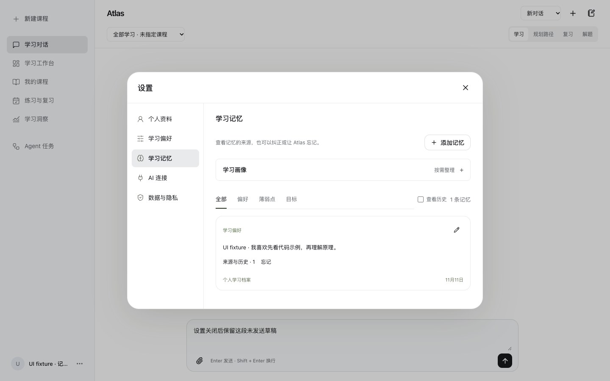
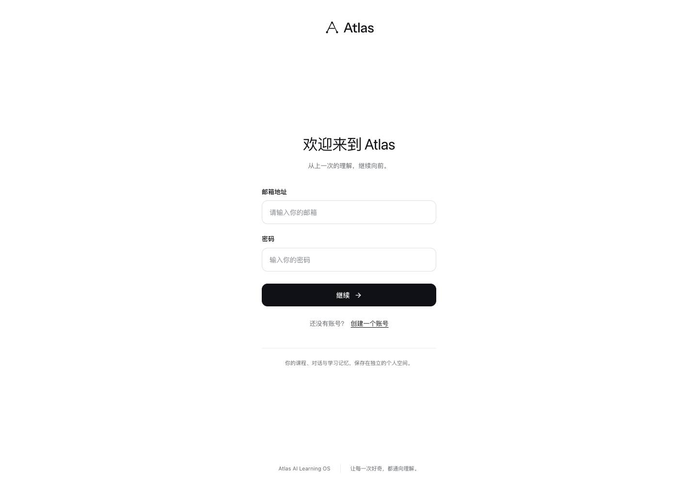
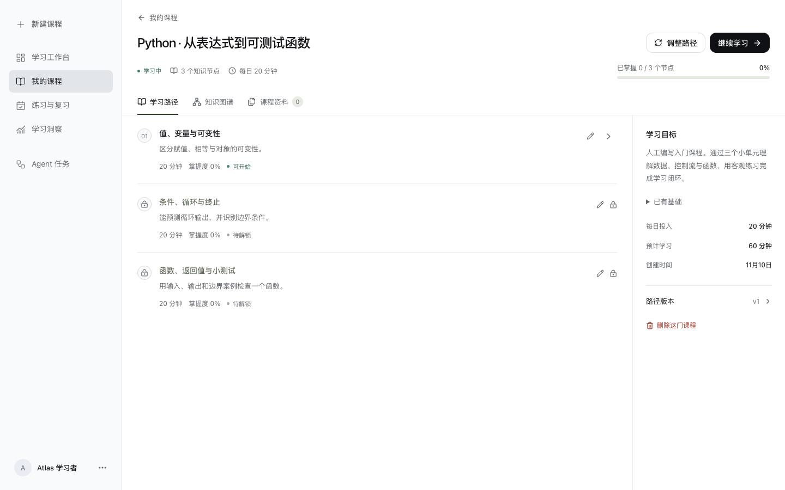
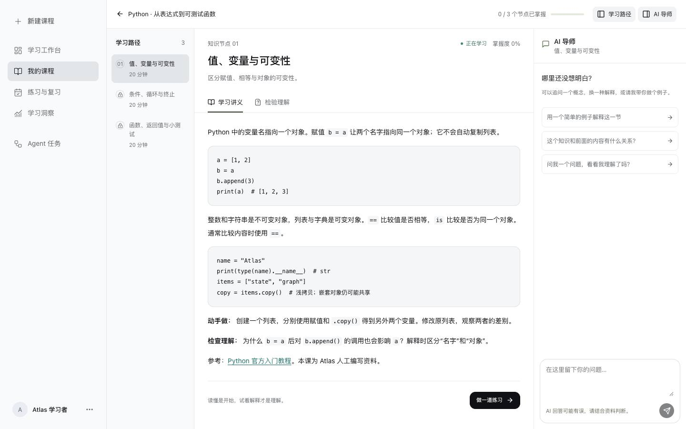
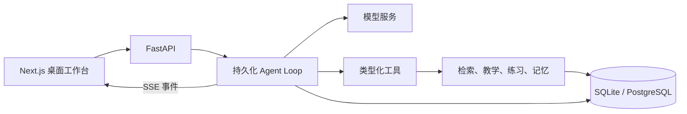

# Atlas · AI Learning OS

Atlas 是一个以聊天为入口的 AI 学习工作台。输入目标或上传教材，Tutor 会结合资料和真实答题记录，帮助你规划课程、理解知识、练习和复习。

**Next.js 16 · React 19 · TypeScript · FastAPI · SQLite / PostgreSQL**

[快速启动](#快速启动) · [Agent 架构](#agent-架构) · [接口约定](docs/API_CONTRACT.md) · [演示与讲解](docs/AGENT_INTERVIEW.md)



截图使用临时账号和合成学习记录。

<details>
<summary>更多桌面截图</summary>





</details>

## 快速启动

需要 **Node.js 22+、Python 3.11+**。本地启动使用 SQLite。

```bash
git clone https://github.com/Jasper-419/atlas-learning-os.git
cd atlas-learning-os
python3 scripts/dev.py
```

脚本创建独立的 `.venv-atlas`、安装前后端依赖、在缺少 `.env` 时复制配置模板，并启动两个服务：

- 产品：[http://127.0.0.1:3000](http://127.0.0.1:3000)
- API 文档：[http://127.0.0.1:8000/docs](http://127.0.0.1:8000/docs)
- 健康检查：[http://127.0.0.1:8000/health](http://127.0.0.1:8000/health)

如果 macOS 上的 pip 提示 `CERTIFICATE_VERIFY_FAILED`，可用系统 CA 证书重试 `PIP_CERT=/etc/ssl/cert.pem python3 scripts/dev.py`。

按 `Ctrl+C` 同时停止两个服务。端口被占用时可指定：

```bash
python3 scripts/dev.py --port 3001 --api-port 8001
```

已有依赖时，也可分别启动：

```bash
.venv-atlas/bin/python -m uvicorn backend.main:app --host 127.0.0.1 --port 8000
npm --prefix frontend run dev
```

注册自己的账号后，从“新建学习目标”选择一门**人工编写入门课程**即可直接学习。Python、LangGraph、RAG 三套课程均含真实正文和客观练习，不依赖 AI 服务生成。自定义课程、AI Tutor、开放题评分与研究综合需要可用的模型配置。

## Agent 架构



Agent Loop 通过原生工具调用执行 33 项操作，按 5 种能力模式限制权限与预算。会话、轮次、检查点和工具回执支持断线重连与恢复。重大课程路径变更需要用户确认，运行详情可查看模型与工具调用。

检索保留原查询，按需改写与重排，并支持按版本和页码回读原文。长期记忆绑定用户原文或真实作答，支持跨会话召回、修订、遗忘与带引用的学习画像。LangGraph 承担独立的规划与研究工作流。[Agent 实现](docs/TUTOR_CORE.md) · [检索与记忆](docs/RETRIEVAL_MEMORY.md)

## 配置模型和资料研究

用户可在侧栏底部账户菜单打开设置，进入 **AI 连接 → 添加连接**，填写自己的 API 地址、协议、API Key 和模型 ID。支持 DeepSeek、OpenAI、Anthropic 预设及自定义中转或本地服务；协议支持 OpenAI Chat Completions、OpenAI Responses 和 Anthropic Messages。

可获取服务提供的模型列表，也可手动填写多个模型并选择默认模型；“测试连接”会发送一条简短请求。保存后在“当前使用”中切换连接，下次课程规划、AI Tutor、开放题评分和研究综合请求立即生效，无需重启。每个账号的连接独立保存；首次添加自动选中，后续添加可自行切换。编辑时 API Key 留空保留原密钥，更换地址或协议后需要重新填写，也可明确清除密钥用于无鉴权的本地服务。

密钥使用 Fernet 加密保存在独立凭据表中，不通过设置读取接口、学习数据导出或模型错误回传。默认自动生成 `data/.credentials.key`（权限 `0600`），备份或迁移时应与数据库一起保留。多主机部署可用 `ATLAS_CREDENTIALS_KEY` 指定同一把 Fernet 密钥，API 与 Worker 必须一致；项目 Docker 配置通过共享 `atlas_data` 卷保留自动生成的密钥。

管理员仍可编辑项目根目录 `.env` 提供服务端默认模型。用户选择“服务端默认”时使用该配置；自定义连接失败会直接报错，不会改用其他连接。已有 `.env` 不会被启动脚本覆盖，密钥只由后端读取。

OpenAI 或兼容 API：

```dotenv
OPENAI_API_KEY=your-key
OPENAI_BASE_URL=https://api.openai.com/v1
OPENAI_MODEL=gpt-4o-mini
```

DeepSeek 示例：

```dotenv
OPENAI_API_KEY=
DEEPSEEK_API_KEY=your-key
OPENAI_BASE_URL=https://api.deepseek.com/v1
OPENAI_MODEL=deepseek-flash
```

修改配置后重启后端。只设置 `DEEPSEEK_API_KEY` 时，Atlas 默认使用 DeepSeek 官方地址和当前可用的 `deepseek-flash`；也可通过 `OPENAI_BASE_URL`、`OPENAI_MODEL` 显式覆盖。当前 DeepSeek 环境已完成真实课程生成、RAG 教学、流式 Tutor、开放题评分、资料研究及重规划验收。详见 [验证记录](docs/VERIFICATION.md)。

DeepSeek 接口默认启用思考模式；Atlas 的常规教学和结构化生成显式关闭该模式，减少等待时间并确保响应包含可直接显示的正文。依据：[DeepSeek 官方接口文档](https://api-docs.deepseek.com/api/create-chat-completion/)。

可选能力：

| 变量 | 作用 |
| --- | --- |
| `EMBEDDING_MODEL` | 启用语义与关键词混合检索；留空时使用关键词检索 |
| `EMBEDDING_API_KEY` / `EMBEDDING_BASE_URL` | 独立向量服务配置；未设置时沿用聊天服务 |
| `TAVILY_API_KEY` | 启用实际联网搜索；未设置时明确使用公开文档 URL 研究 |
| `DATABASE_URL` | 业务数据库；未设置时为 `data/atlas.db` |
| `CHECKPOINT_DATABASE_URL` | PostgreSQL LangGraph checkpoint；未设置时为 `data/checkpoints.db` |
| `WORKER_MODE` | `embedded`（默认）、`celery` 或 `disabled` |
| `MAX_UPLOAD_MB` | 文件大小限制，默认 12 MB |

`.env.example` 还列有 Cookie、CORS、Redis 等配置。Embedding 应使用专门的向量模型，不能填写聊天模型名。

上传资料后 Atlas 默认自动索引和检索。通用问题用 LlamaIndex，文本 PDF 的页码与章节问题优先用 PageIndex，跨资料关系问题可按需用 LightRAG。「课程资料 → 高级检索设置」提供手动选择。[检索引擎与配置](docs/RETRIEVAL_MEMORY.md#课程知识库检索引擎)

## 已交付功能

| 区域 | 功能 |
| --- | --- |
| 账户与隔离 | 注册登录、HttpOnly 会话、注销、服务端资源归属校验、密码确认删号 |
| 学习工作台 | 真实课程进度、最近足迹、到期复习、继续学习 |
| 课程规划 | 学习目标、基础、水平、每天时间和期限；持久化后台规划与失败重试 |
| 知识路径 | DAG 校验与拓扑排序、可交互图谱、节点编辑、先修关系编辑、版本和调整理由 |
| AI 教学 | 有预算的原生工具循环、学习/规划/复习模式、讲义与证据、相关记忆、历史摘要、暂停提问与续答 |
| 课程资料 | PDF/TXT/MD/DOCX 持久导入、内容去重、文本录入、检索、删除、分主题资料研究 |
| 检索 | 上传后自动索引、按问题路由到 LlamaIndex、PageIndex 或 LightRAG、按需回读原文版本 |
| 练习评估 | 选择题规则评分、开放题 Rubric + 模型、标准答案保护、提交幂等 |
| 自适应 | 动态补题、首答独立证据、掌握置信门槛、先修解锁、具体误解记忆、精确预览确认路径变更 |
| 学习记忆 | 用户原文来源、个人/课程隔离、修订/忘记/删除、跨会话召回、带逐字引用且可失效的学习画像 |
| 间隔复习 | 到期队列、复习自评、错误优先、基于学习证据与自评调整间隔 |
| 研究和任务 | 研究/规划/重规划、进度、取消、独立重试、持久化 checkpoint、租约恢复 |
| 执行追踪 | 步骤、模型、实际 Token 用量、耗时、错误与研究结果 |
| 对话恢复 | 持久会话/轮次/事件、SSE游标重连、任务租约、幂等工具、取消写入栅栏 |
| Agent 工程 | 33项类型化独立工具、5种Capability、冻结执行策略、有限重试与恢复回执、嵌套模型span、运行详情弹窗与脱敏导出 |
| 可验证解题 | 最多6步计划、受限Python子进程、真实输出与检查、绑定计划/步骤的执行凭据、区分执行校验与推理说明 |
| 练习核验 | 明确重点与节点范围检查、独立题目/答案/来源核验、最多一次修正、私有合同指纹及历史核验标识 |
| 数据管理 | 学习分析、个人档案、JSON 导出、删除课程/资料/记忆/账号 |

自适应采用透明规则，不声称具备经实验证明的教学效果。重大课程结构调整由用户触发，避免后台自行产生模型费用。取消任务会阻止后续保存，但不能撤销供应商已经处理的 HTTP 请求和费用。

## Docker 部署

确保 Docker 正在运行，并创建 `.env`：

```bash
cp .env.example .env  # 仅在尚未创建 .env 时执行
docker compose up --build -d
```

包含 Next.js、FastAPI、PostgreSQL 16 + pgvector、Redis 和 Celery worker/beat。只暴露 Web 的 3000 端口；数据库、Redis 和 API 位于容器内部网络。数据保存在命名卷。

```bash
docker compose logs -f api worker web
docker compose down
```

`down` 保留数据卷。更换外部访问域名时，在 `.env` 设置实际 `CORS_ORIGINS`；HTTPS 部署设置 `COOKIE_SECURE=true`，并在入口反向代理中启用 TLS。数据库密码使用 URL 安全字符，部署前替换模板值。Next.js 的 `API_URL` 作为构建参数写入代理配置，Compose 已配置为 `http://api:8000`。

**本机 Docker daemon 未运行，容器配置已通过解析，尚未进行整套容器运行验收。** PostgreSQL/pgvector 的数据库方言和迁移 SQL 已验证，实际实例、Celery/Redis、Tavily 与 embedding 服务仍需在配置好的部署环境验证。

## 数据与迁移

启动 API 时自动执行 `alembic upgrade head`。也可以手动执行：

```bash
.venv-atlas/bin/alembic upgrade head
```

业务表以 `atlas_` 开头，不覆盖旧 Paper Assistant 的 `users` 表；切换后请注册 Atlas 账号。所有权由服务端会话决定，不能通过修改浏览器存储取得其他账号数据。

本地业务数据、checkpoint 与新导入的原始附件位于 `data/`，均被 Git 忽略。备份时应保留完整数据目录与凭据加密密钥。旧上传入口仅保存提取后的文本块；新聊天导入同时保留原始附件。扫描版 PDF 需要先 OCR。

## 必要验证

保留直接覆盖核心链路的检查，不建立覆盖率或基准测试平台：

```bash
npm --prefix frontend run typecheck
npm --prefix frontend run build
.venv-atlas/bin/python -m compileall -q backend migrations
.venv-atlas/bin/python -m backend.tests.smoke
.venv-atlas/bin/python -m backend.tests.workflow_smoke
.venv-atlas/bin/python -m backend.tests.tutor_smoke
docker compose config --quiet
```

第一份后端检查覆盖账户与原有业务闭环。workflow 与 tutor 检查使用**明确标识的外部模型 fixture**，验证真实数据库、worker、工具执行、取消和恢复；真实模型及桌面验收单独记录，详见验证文档。

实际验证记录见 [docs/VERIFICATION.md](docs/VERIFICATION.md)，后端细节和限制见 [docs/backend-implementation.md](docs/backend-implementation.md)。未测量的成功率、检索准确率、性能或成本不列为项目成果。

Agent开发讲解与5分钟演示见 [AGENT_INTERVIEW](docs/AGENT_INTERVIEW.md)，小规模任务评估与真实模型记录见 [AGENT_EVALUATION](docs/AGENT_EVALUATION.md)。默认离线命令 `.venv-atlas/bin/python scripts/evaluate_agent.py` 使用明确标识的外部模型fixture和真实API/数据库；显式 `--mode live` 才请求配置模型。脚本契约通过不等同于模型回答质量或教学效果。

PDF 证据页与首条引用的对照方法、完整公开样本和复现命令见 [FinanceBench 评测](evaluations/retrieval/FINANCEBENCH.md)。

本地模型的教学对照与跨会话记忆评测见 [TutorBench 与学习场景](evaluations/tutorbench/README.md)。

## 项目结构

```text
frontend/       Next.js App Router、React 页面、课程图谱与学习工作区
backend/        FastAPI、数据模型、教学/评分、RAG、LangGraph、任务 worker
migrations/     Alembic 迁移
scripts/dev.py  一键本地启动与依赖准备
docs/           API 约定、交付设计、验证记录和实施说明
docker-compose.yml
```

技术参考：[Next.js 官方文档](https://nextjs.org/docs)、[LangGraph 持久化](https://docs.langchain.com/oss/python/langgraph/persistence)、[FastAPI](https://fastapi.tiangolo.com/)、[pgvector](https://github.com/pgvector/pgvector)。
